# VOID // APPS

**An Android app manager that runs through Shizuku, without root, and refuses to guess.**


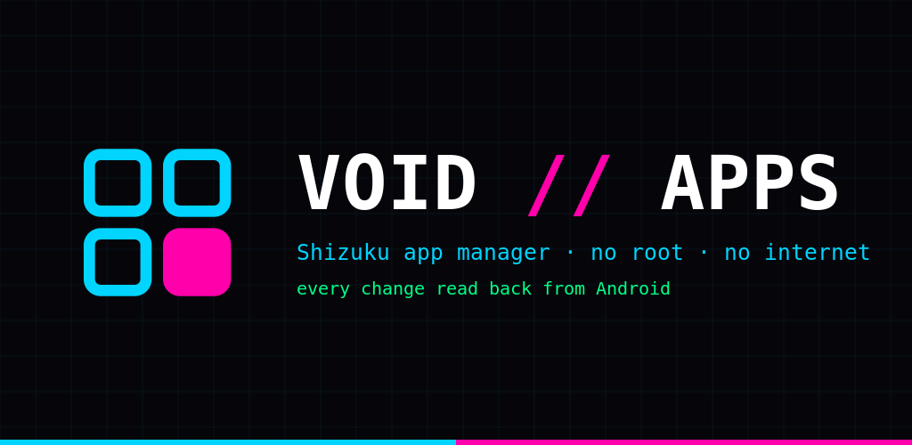

VOID // APPS is a native Kotlin + Jetpack Compose app. Every action is a shell command sent through the [Shizuku](https://shizuku.rikka.app/) UserService as the shell user (uid 2000). After each change it asks Android again and only then reports the result:

| Verdict | Meaning |
|---|---|
| **applied** | the read-back shows the new state |
| **not applied** | the command ran (often with exit 0) but Android kept the old state |
| **unverifiable** | Android offers no way to read this change back |
| **refused** | blocked by the app's own guard, nothing was run |
| **failed** | the command could not run |

The exact command, its output and the before/after state are always one tap away, with Copy and Share.

<table>
  <tr>
    <td width="33%">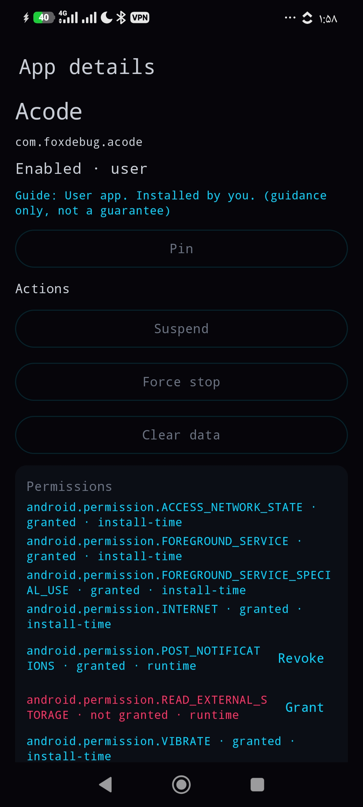</td>
    <td width="33%">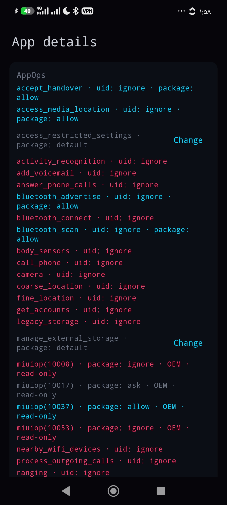</td>
    <td width="33%">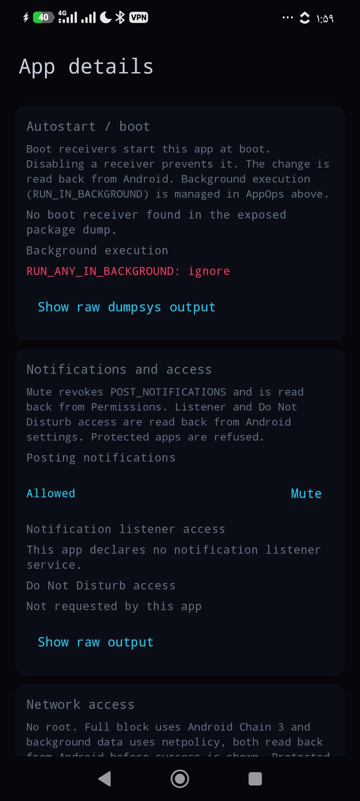</td>
  </tr>
  <tr>
    <td width="33%">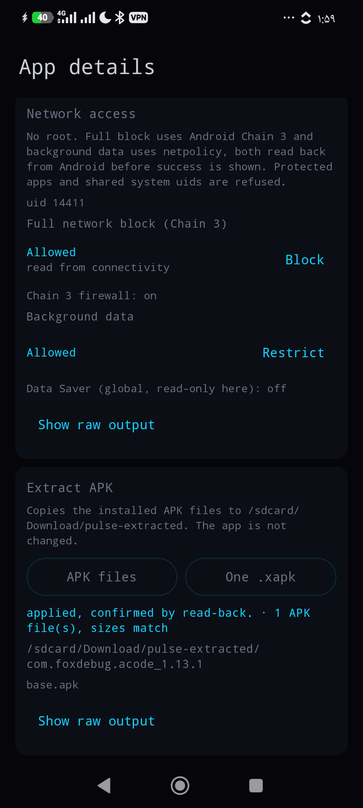</td>
    <td width="33%">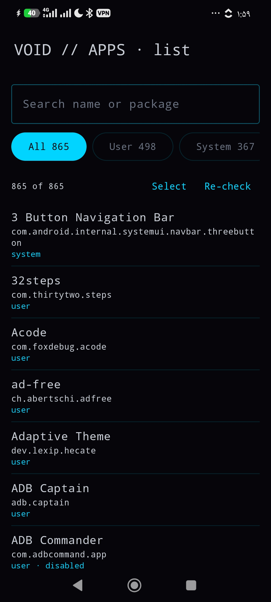</td>
    <td width="33%">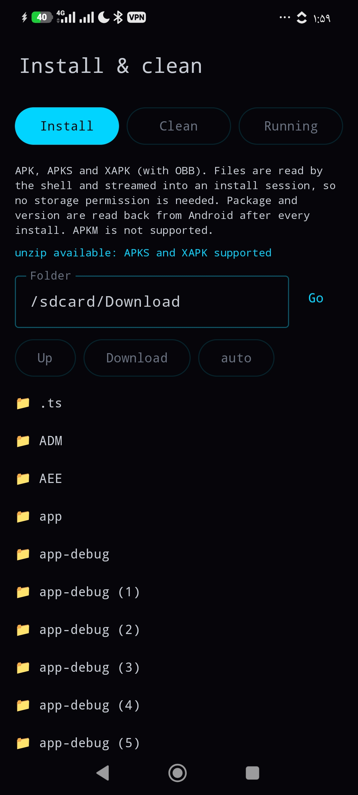</td>
  </tr>
  <tr>
    <td width="33%">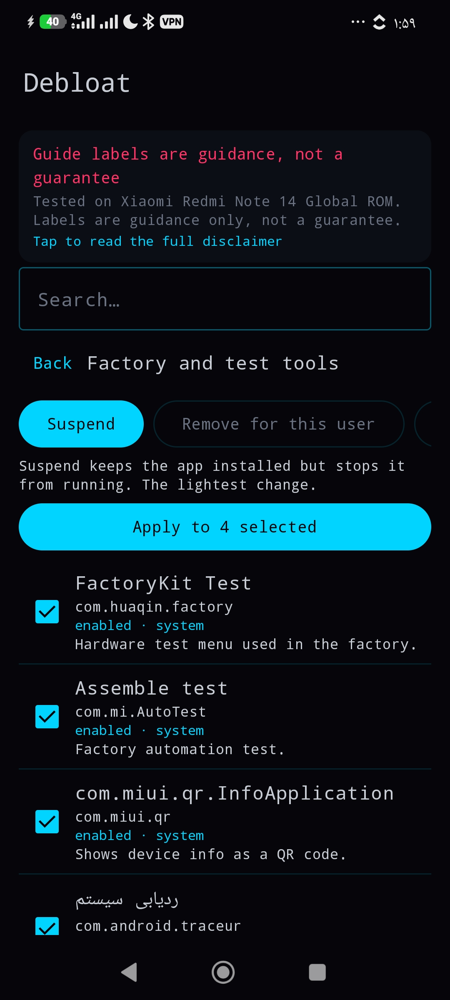</td>
    <td width="33%">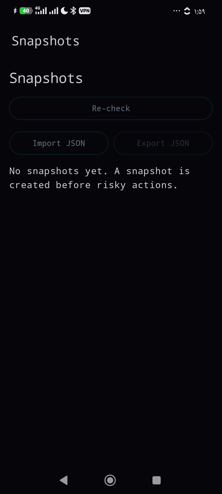</td>
    <td width="33%">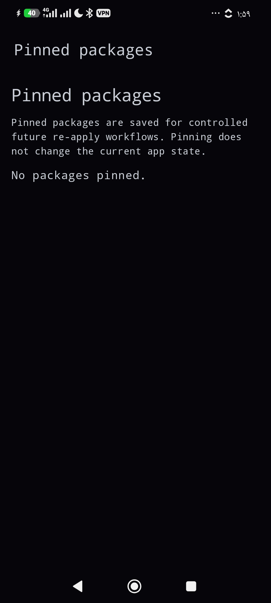</td>
  </tr>
  <tr>
    <td width="33%">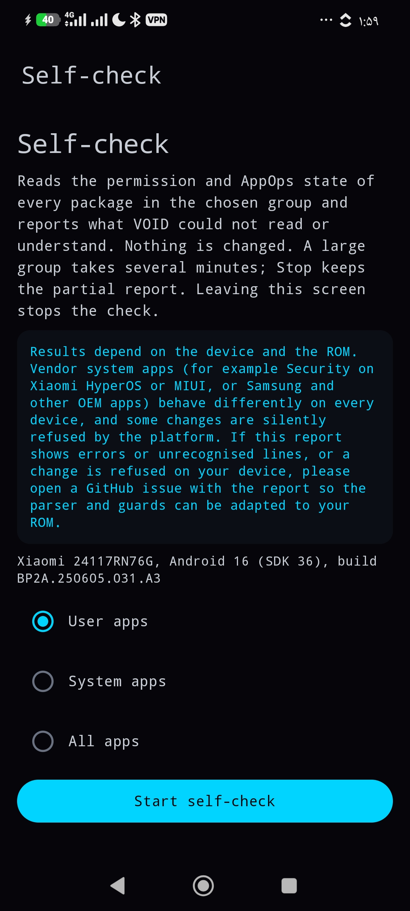</td>
    <td width="33%">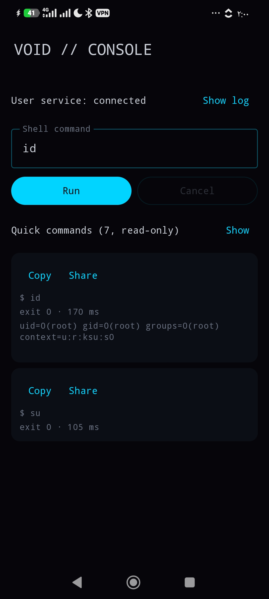</td>
    <td width="33%">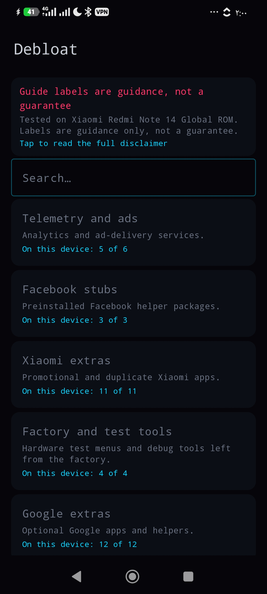</td>
  </tr>
</table>

## What it does

**Apps**
- Full package list for user 0 with search and filters: user, system, disabled, suspended, removed, protected.
- Suspend / unsuspend, disable / enable, force stop, remove for this user, restore (`pm install-existing`, also for packages another manager removed), clear data.
- Snapshots before risky changes, restore with per-package read-back (undo), JSON import and export, pinned packages, batch actions with one snapshot per batch.

**Debloat**
- Presets built from a package knowledge base with Safe / Caution / Core labels, a review screen, search, and a disclaimer that says what it is: guidance tested on one phone, not a guarantee.

**Per-app cards in app details**
- **Permissions**: runtime grant / revoke checked with `pm check-permission`; install-time and fixed permissions shown read-only; shared system uid refused.
- **AppOps**: uid and package scope shown separately; package-scope changes only where no uid mode overrides them; OEM `MIUIOP(n)` modes shown but never written.
- **Autostart**: boot receivers from the Receiver Resolver Table, background execution ops, component disable / enable.
- **Notifications**: mute (POST_NOTIFICATIONS), notification listener access, Do Not Disturb access.
- **Network**: full block through Android 11+ Chain 3 (`cmd connectivity set-package-networking-enabled`), background data through `netpolicy`, shared-uid warning.
- **Extract**: copy the installed base and split APKs, or build one `.xapk`.

**Install & clean**
- Installer for APK, APKS and XAPK with OBB. The shell reads the file from `/sdcard` and streams it into a `pm install-create` session, so the app needs no storage permission. Inspect shows package, version, SDK, ABIs, launcher entry, permissions, SHA-256 and the installed version (with a downgrade warning). A built-in binary-manifest reader gives the package name, which is how an install is verified. Auto-install folder and local history included. APKM is not supported.
- Trim all app caches (free space measured before and after), remove empty folders (`rmdir` only), list apps with live processes and stop them with a fresh process check afterwards.

**Also**: a read-only Self-check for whole package groups, a ROM report template, and a console with read-only quick commands.

## Safety model

- One guard for the whole app (`inventory/ProtectedPackages.kt`). Framework, System UI, Settings, phone and telecom, package installers, permission controller, network stack, Shizuku, the current launcher, keyboard, default dialer, default SMS app and WebView provider are refused **in the repository layer**, not only hidden in the UI.
- Package and component names are validated and every argument is shell-quoted.
- No INTERNET permission. Nothing leaves the phone.
- ExecBridge caps output at 64 KiB; parsers are measured on the phone and a truncated read is treated as "unknown", never as a state.
- A write button appears only where a phone test showed Android really accepts that change.

## Honest limits

- Tested on **one** reference phone: Xiaomi Redmi Note 14 4G, HyperOS Global, Android 16 (SDK 36), Shizuku as uid 2000. Other ROMs can and will differ; the verdicts are built to show that instead of hiding it.
- **Open:** boot receivers listed in shorthand form (`pkg/.Cls`): the device state changes, but the card's button state does not follow yet. See `docs/PLAN.md`.
- **Open:** Do Not Disturb access on HyperOS: `cmd notification allow_dnd` exits 0 and changes nothing. The app reports *not applied*.
- Chain 3 network blocks may not survive a reboot on every ROM.
- A root mode is planned for 2.0 and is not implemented yet. The plan, section by section, is in `docs/ROOT_FUTURE.md`.

## Requirements and install

- Android 8.0 or newer.
- [Shizuku](https://shizuku.rikka.app/) running, through wireless debugging, ADB or root.
- Install the APK from [Releases](https://github.com/privshell/void-apps/releases/latest) (or F-Droid once published), open it, grant the Shizuku permission.

## Build

```sh
cd android-app
gradle :app:testDebugUnitTest :app:assembleDebug
```


JDK 17, Android SDK 36, Gradle 8.13. CI (.github/workflows/ci.yml) runs unit tests, lint and the debug build on every push, and a signed release build when the signing secrets exist (see docs/RELEASE.md).

Development notes

The native app was built on the branch native-app-v0: 127 commits up to the A8 docs, plus the release commits, 106 of them native-only. Every section was tested on the reference phone as one unit before the next one started. The commit history is preserved to show the development process and past iterations.


## Credits

Commands and behaviour were ported from independent Android power tools and development scripts. Build and Shizuku core from [PULSE // BATTERY](https://github.com/privshell/pulse-battery). KernelSU modules and management logic from [SELINUX // MANAGER](https://github.com/privshell/selinux-manager) and [APEX // APPS](https://github.com/privshell/apex-apps).
[aegis-firewall](https://github.com/privshell/aegis-firewall).  [orbit-store](https://github.com/privshell/orbit-store) 

Built on [Shizuku](https://github.com/RikkaApps/Shizuku) by RikkaApps.


Disclaimer

Disabling or removing the wrong package can break features of your phone, including ones no tool can detect. Labels and presets are guidance from one tested phone, not a guarantee. Snapshots make changes made by this app reversible; use them.

Support

VOID // APPS is free, open source and asks for no internet permission, built in spare time. If it saved you time, you can support the work with a small crypto donation (USDT on TRC20, or USDC / SOL on Solana). Starring the repo or opening a clear issue helps just as much.

License

MIT, see LICENSE.
